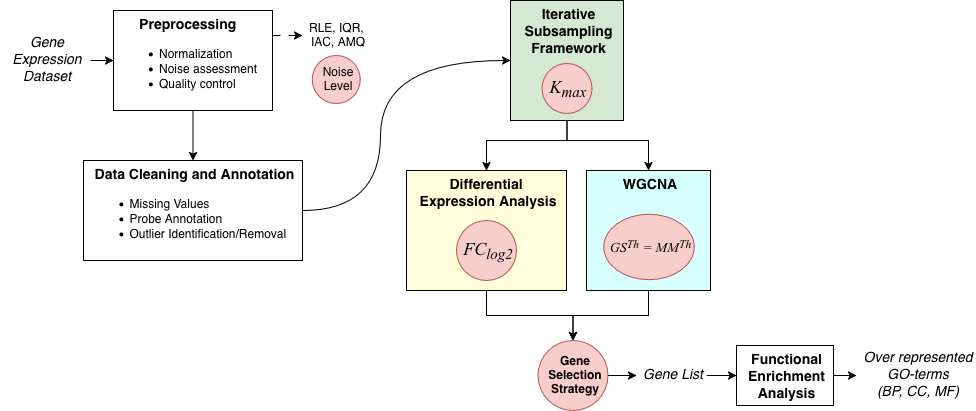

# Description 
Code for paper 

> *Practical Use of Differential Expression Analysis and WGCNA in Transcriptomics: A Methodological Assessment*  
> Samreen Shabir <sup>(1)</sup>, Alessio Bechini <sup>(1)</sup>, Alessandro Renda <sup>(1,2)</sup>  
> 1) University of Pisa, Pisa, Italy
> 2) University of Trieste, Trieste, Italy
> 
> Status: under review


### Abstract

Analysis of gene expression data is a crucial Bioinformatics tool for Transcriptomics investigations. 
Among the proposed approaches, methods for assessing differential gene expression and for characterizing the corresponding co-expression network provide alternative views of the information present in a gene expression dataset.
Such approaches can be used either separately or jointly.
Their performance, however, depends on the choice of parameter values, which may significantly affect the outcomes.
Thus, having a clear view of the possible influence of parameter values on the analysis results is particularly important and practically challenging.
This work introduces an empirical framework to investigate the impact of parameter settings on the analysis results, providing insights into the advantages and limitations of using the two approaches.
After identifying the main factors that affect the robustness of the investigated methods, systematic computational experiments have been carried out over publicly available datasets. 
The results help better understand the behavior of the methods across varying operating conditions, offering practical methodological guidance for their effective application and for assessing the reliability of the outcomes.


### Graphical abstract

Schematic view of the analysis pipeline considering DEA and WGCNA. Aspects/parameters investigated for their influence on the outcomes are indicated in orange balls.



# Dependencies

### Gene Selection
The analysis was carried out using R and Bioconductor. Please ensure that the required packages are installed before running the pipeline.

```
if (!require("BiocManager", quietly = TRUE))
  install.packages("BiocManager")
BiocManager::install(version = "3.19")
BiocManager::install("GEOquery")
BiocManager::install("WGCNA", dependencies = TRUE, force = TRUE)
BiocManager::install("org.Mm.eg.db")
BiocManager::install("GO.db")
BiocManager::install("impute")
```

### Functional Enrichment Analysis, post-processing, plotting

The analysis was carried out using Python and anaconda package and environment manager. Please ensure that the required packages are installed before running the pipeline.

```
conda create -n PEERJ -c conda-forge \
  python=3.10 \
  numpy pandas scipy scikit-learn statsmodels \
  matplotlib seaborn \
  jupyterlab notebook ipykernel \
  openpyxl tqdm requests lxml \
  goatools graphviz python-graphviz pydot \
  certifi ca-certificates openssl \
  -y

python -m pip install suds-py3
```

# Usage

### Step 1: Gene Selection

Run the main pipeline by specifying the dataset identifier:

`$ Rscript main.R --dataset=DATASET_ID`

The selected dataset must be present in `dataset_config.csv`: the file contains the datasets metadata used for the experimental analysis described in the paper. To analyze additional datasets, please update the `dataset_config.csv` file and create a dedicated folder with the relevant csv files (expression data and clinical traits).

For each execution, the pipeline creates an output directory named according to the execution date: `YYYY_MM_DD/DATASET_ID/` and saves the relevant results therein.


### Step 2: Functional Enrichment Analysis (FEA)

Run the FEA pipeline by specifying:
- the email address associated with a registered DAVID account;
- the base output directory generated by Step 1.

```bash
python fea.py \
  --david_email=YOUR_EMAIL \
  --base_dir=YYYY_MM_DD
```


>Note: All enrichment analyses reported in our work were performed using the DAVID Knowledgebase version `v2025_2`, corresponding to the release active at the time of execution of the experiments. (12/31/2025)

### Step 3: Results processing

After FEA, run the post-processing scripts to generate the input tables used for the analysis of the three research questions.

The scripts process all dataset folders contained in the selected day directory and save the resulting tables in `ImgOut/YYYY_MM_DD/`.

Run the scripts from the repository root:
```bash
python scripts/RQ1.py --day_dir=YYYY_MM_DD
python scripts/RQ2.py --day_dir=YYYY_MM_DD
python scripts/RQ3.py --day_dir=YYYY_MM_DD
```

### Step 4: Plot generation

The final figures are generated from the processed tables produced in Step 3.

Run the notebooks corresponding to each research question.  Before execution, set the `DS_DIR` variable in the first cell to the appropriate dataset directory.

```text
notebooks/RQ1.ipynb
notebooks/RQ2.ipynb
notebooks/RQ3.ipynb
```

The notebooks generate the final plots used for the analysis and manuscript figures.
